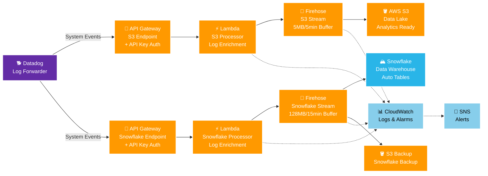
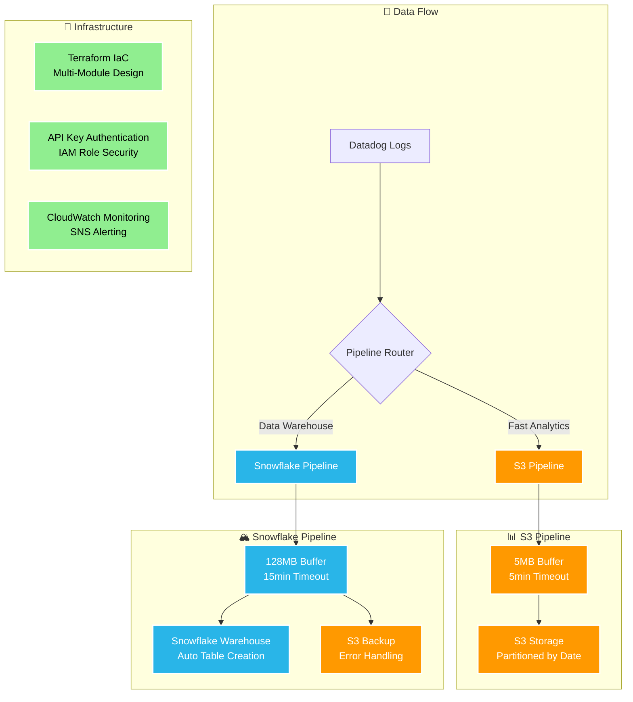

- [Datadog to AWS Data Pipeline](#datadog-to-aws-data-pipeline)
  - [🏗️ Architecture](#️-architecture)
    - [Pipeline Details](#pipeline-details)
  - [🚀 Features](#-features)
  - [📋 Prerequisites](#-prerequisites)
  - [🛠️ Setup](#️-setup)
    - [1. Install Datadog Agent (Optional - for log generation)](#1-install-datadog-agent-optional---for-log-generation)
    - [2. Generate Snowflake Keys (Snowflake Pipeline Only)](#2-generate-snowflake-keys-snowflake-pipeline-only)
    - [3. Configure Terraform](#3-configure-terraform)
    - [4. Deploy Infrastructure](#4-deploy-infrastructure)
    - [5. Configure Datadog Log Forwarding](#5-configure-datadog-log-forwarding)
  - [🧪 Testing](#-testing)
    - [Test Lambda Functions Directly](#test-lambda-functions-directly)
    - [Test API Gateway Endpoints](#test-api-gateway-endpoints)
    - [Generate Test Logs](#generate-test-logs)
  - [� Configuration](#-configuration)
    - [Buffer Settings](#buffer-settings)
    - [Security](#security)
  - [📊 Monitoring](#-monitoring)
  - [🔍 Troubleshooting](#-troubleshooting)
    - [Common Issues](#common-issues)
    - [Debug Commands](#debug-commands)
  - [🏷️ Adding New Pipelines](#️-adding-new-pipelines)
  - [📄 License](#-license)


# Datadog to AWS Data Pipeline

A Terraform-managed infrastructure for streaming Datadog logs to AWS S3 and Snowflake destinations via API Gateway, Lambda, and Kinesis Firehose.

## 🏗️ Architecture



### Pipeline Details



## 🚀 Features

- **Dual Destinations**: Stream to both S3 and Snowflake simultaneously
- **Auto-scaling**: Lambda and Firehose handle variable log volumes
- **Automatic Tables**: Snowflake tables created automatically via Terraform
- **Security**: API key authentication and IAM role-based access
- **Monitoring**: CloudWatch alarms and SNS notifications
- **Cost Optimized**: Different buffer settings per destination

## 📋 Prerequisites

- AWS CLI configured
- Terraform >= 1.0
- Datadog account with API access
- Snowflake account (for Snowflake pipeline)
- OpenSSL (for key generation)

## 🛠️ Setup

### 1. Install Datadog Agent (Optional - for log generation)

```bash
export DD_API_KEY="your_datadog_api_key"
export DD_SITE="datadoghq.com"
bash -c "$(curl -L https://install.datadoghq.com/scripts/install_script_agent7.sh)"
```

### 2. Generate Snowflake Keys (Snowflake Pipeline Only)

```bash
# Generate RSA key pair
cd snowflake/
../generate_snowflake_keys.sh

# Follow the script output to:
# 1. Add public key to Snowflake user
# 2. Update terraform.tfvars with private key
```

### 3. Configure Terraform

```bash
# Copy and customize configuration
cp terraform.tfvars.example terraform.tfvars

# Edit terraform.tfvars with your values:
# - AWS region
# - Snowflake credentials  
# - Alert email
# - Buffer settings
```

### 4. Deploy Infrastructure

```bash
terraform init
terraform plan
terraform apply
```

### 5. Configure Datadog Log Forwarding

1. Go to [Datadog Log Forwarding](https://app.datadoghq.com/logs/pipelines/log-forwarding/custom-destinations)
2. Create custom destinations using the API Gateway URLs and keys from Terraform outputs

```bash
# Get API endpoints and keys
terraform output api_gateway_urls
terraform output api_key_values
```

## 🧪 Testing

### Test Lambda Functions Directly

```bash
# Test S3 pipeline
aws lambda invoke \
  --function-name "datadog-system-events-s3-processor" \
  --payload '{"body": "{\"test\": \"message\", \"timestamp\": \"2025-01-15T10:00:00Z\"}"}' \
  response.json && cat response.json

# Test Snowflake pipeline  
aws lambda invoke \
  --function-name "datadog-system-events-snowflake-processor" \
  --payload '{"body": "{\"test\": \"message\", \"timestamp\": \"2025-01-15T10:00:00Z\"}"}' \
  response.json && cat response.json
```

### Test API Gateway Endpoints

```bash
# Get URLs and keys from Terraform
S3_URL=$(terraform output -json api_gateway_urls | jq -r '.system_events_s3')
S3_KEY=$(terraform output -json api_key_values | jq -r '.system_events_s3')

SNOWFLAKE_URL=$(terraform output -json api_gateway_urls | jq -r '.system_events_snowflake')  
SNOWFLAKE_KEY=$(terraform output -json api_key_values | jq -r '.system_events_snowflake')

# Test S3 endpoint
curl -X POST "$S3_URL" \
  -H "Content-Type: application/json" \
  -H "x-api-key: $S3_KEY" \
  -d '{"test": "message", "timestamp": "'$(date -u +%Y-%m-%dT%H:%M:%S.%3NZ)'"}'

# Test Snowflake endpoint
curl -X POST "$SNOWFLAKE_URL" \
  -H "Content-Type: application/json" \
  -H "x-api-key: $SNOWFLAKE_KEY" \
  -d '{"test": "message", "timestamp": "'$(date -u +%Y-%m-%dT%H:%M:%S.%3NZ)'"}'
```

### Generate Test Logs

```bash
# Using log generator (if available)
export DD_API_KEY="your_datadog_api_key"
python datadog_log_generator.py --dd-api-key $DD_API_KEY --total-logs 50 --rate 5
```

## 🔧 Configuration

### Buffer Settings

- **S3 Pipeline**: 5MB / 5 minutes (faster delivery)
- **Snowflake Pipeline**: 128MB / 15 minutes (cost optimized)

### Security

- API key authentication for all endpoints
- IAM roles with minimal required permissions
- Private key authentication for Snowflake

## 📊 Monitoring

- CloudWatch logs for Lambda functions
- CloudWatch alarms for Firehose delivery failures
- SNS notifications for alerts
- Datadog log pipeline monitoring

## 🔍 Troubleshooting

### Common Issues

1. **API Gateway 500 errors**: Check Lambda logs in CloudWatch
2. **Snowflake connection**: Verify organization/account names and private key format
3. **Missing data**: Check Firehose delivery streams and S3/Snowflake permissions

### Debug Commands

```bash
# Check Lambda logs
aws logs filter-log-events --log-group-name "/aws/lambda/datadog-system-events-s3-processor" --start-time $(date -d '1 hour ago' +%s)000

# Check Firehose metrics
aws cloudwatch get-metric-statistics --namespace AWS/Firehose --metric-name DeliveryToS3.Records --start-time $(date -d '1 hour ago' -u +%Y-%m-%dT%H:%M:%S) --end-time $(date -u +%Y-%m-%dT%H:%M:%S) --period 300 --statistics Sum
```

## 🏷️ Adding New Pipelines

To add a new event type (e.g., `user-events`):

1. Create new pipeline file: `firehose_user_events.tf`
2. Add module call with `event_name = "user-events"`
3. Update `output.tf` to include new pipeline in `all_pipelines`
4. Run `terraform apply`

The infrastructure will automatically:
- Create unique Lambda functions
- Generate API Gateway endpoints  
- Create Snowflake tables (if applicable)
- Set up monitoring and alerts

## 📄 License

MIT License - see [LICENSE](LICENSE) file for details.

---

**💡 Tip**: Use [Datadog Log Explorer](https://app.datadoghq.com/logs?stream_sort=desc&viz=stream&live=true) to view your logs in real-time before they're forwarded to AWS.